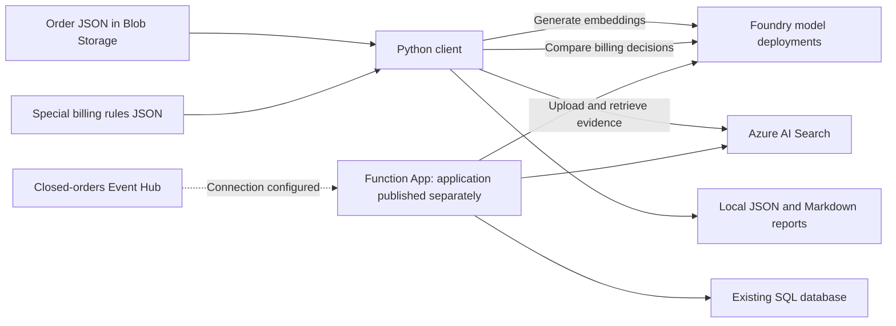

# AI Billing Decision

Azure infrastructure and Python tools for evaluating work-order billing decisions using contract evidence, special billing rules, and similar historical orders.

Terraform provisions the supporting Azure services. The Python client loads evidence into Azure AI Search, builds retrieval-augmented prompts, and compares chat deployments against stored orders. The Azure Function App is configured here, but its .NET application source and application publishing workflow are maintained separately.

## Repository structure

```text
AiBillingDecision/
  environments/
    dev/                     Development Terraform root and local state
    prod/                    Production Terraform root and local state
  shared/                    Blob Storage, Event Hubs, VNet, and subnets
  aiDecision/                Search, Foundry, model deployments, agents, and access
  functions/                 Flex Consumption Function App and monitoring
PythonClient/
  src/                       Indexing, prompt building, and model comparison
  data/special_billing_rules.json
  tests/                     Offline unit tests
  .env.dev.example           Development configuration template
  .env.prod.example          Production configuration template
  requirements.txt
  readme.MD                  Detailed Python behavior and command reference
example/                     Independent Linux VM/Docker Terraform example
```

## How the solution fits together



The `aiDecision` module also creates Foundry prompt agents and connects them to the Search index. Python comparison runs call model deployments directly with application-provided tools; they do not invoke those agents.

Terraform manages infrastructure and the Search index schema. Python uploads the index documents separately. Provisioning the infrastructure does not populate billing evidence or publish the Function application.

## Environments

Dev and prod use separate Terraform directories, subscriptions, local state files, and Python environment files.

| Setting | Dev | Prod |
| --- | --- | --- |
| Terraform root | `AiBillingDecision/environments/dev` | `AiBillingDecision/environments/prod` |
| Subscription | `69feff3c-2c0a-4c0f-b633-367ff3ca483d` | `2f482561-182f-4bd5-840b-1dc7d21f0811` |
| Existing resource group | `aibillingdecision-69fe` | `aibillingdecision-prod` |
| Shared resources / Function region | West US 2 | Canada Central |
| AI module region | Canada Central | Canada Central |
| Storage account | `aibillingstorage69fe` | `aibillingstorageprod` |
| Search service | `ai-billing-search-69fe` | `ai-billing-search-prod` |
| Search index declared by Terraform | `ai-billing-search-69fe-index` | `ai-billing-search-prod-index` |
| Foundry account | `ai-billing-foundry-69fe` | `ai-billing-foundry-prod` |
| Function App | `func-aibilling-decision-69fe` | `func-aibilling-decision-prod` |
| Existing Function integration subnet | `USWest/USWest-vnet/Function` | `Canada/Canada-vnet/Function` |
| Python settings | `PythonClient/.env.dev` | `PythonClient/.env.prod` |
| Default comparison reports | `PythonClient/results/dev/` | `PythonClient/results/prod/` |

Subnet paths above use `resource group / virtual network / subnet`. The environment roots read those subnets with `data.azurerm_subnet.existing_functions` and pass their IDs into the Function module. The shared module still manages a separate `vnet-aibilling` and its database/functions subnets; those managed subnets are not the current Function integration target.

Both environments declare chat deployments named `<search-service-name>-foundry-6.1-sol` and `<search-service-name>-foundry-5.6-sol`. The embedding deployment is `text-embedding-3-small-code-vector`, with 1,536-dimensional vectors. These are configuration names from this repository, not confirmation of what is currently deployed in Azure.

## Prerequisites

- Terraform `>= 1.7.0, < 2.0.0`. The environment roots require AzureRM `~> 5.0.0` and AzAPI `>= 2.9.0, < 3.0.0`.
- Azure CLI and access to the selected subscription. The deployment identity needs permission to manage resources and role assignments, plus the data-plane access used for Search index and Foundry agent management.
- Existing environment resource groups and the integration VNets/subnets shown above. Ensure the selected subnet is ready for the Flex Consumption app's VNet integration.
- An existing SQL database and its connection string. This repository does not provision a SQL server or database.
- Model availability and capacity for the deployments declared in `AiBillingDecision/aiDecision/main.tf`.
- Python with `venv` and `pip`. The local client has been run with Python 3.13; dependencies are listed in `PythonClient/requirements.txt`.

Examples below use PowerShell. Terraform commands run from the repository root; Python commands run from `PythonClient` unless stated otherwise.

## 1. Configure and provision Azure resources

Sign in and select the development subscription:

```powershell
az login
az account set --subscription 69feff3c-2c0a-4c0f-b633-367ff3ca483d
```

For a new local setup, copy the environment's secret template if `secrets.auto.tfvars` does not already exist:

```powershell
Copy-Item AiBillingDecision/environments/dev/secrets.auto.tfvars.example AiBillingDecision/environments/dev/secrets.auto.tfvars
```

Edit the copied file and supply the environment's `sql_connection_string`. Alternatively, provide `TF_VAR_sql_connection_string` through your shell or secret-management workflow.

Initialize, validate, and review the plan:

```powershell
terraform -chdir=AiBillingDecision/environments/dev init
terraform -chdir=AiBillingDecision/environments/dev workspace show
terraform -chdir=AiBillingDecision/environments/dev validate
terraform -chdir=AiBillingDecision/environments/dev plan -out=changes.tfplan
```

Use the `default` workspace. These roots separate environments by directory; clear inherited `TF_WORKSPACE` or `TF_DATA_DIR` overrides if they select another workspace or data directory.

After reviewing the saved plan, apply it:

```powershell
terraform -chdir=AiBillingDecision/environments/dev apply changes.tfplan
```

For production, use the prod subscription from the table and replace `environments/dev` with `environments/prod` throughout. Supply production database credentials separately.

If adopting resources that already exist, reconcile their Terraform state/imports before applying a creation plan. Do not assume a new checkout contains the state for an existing deployment.

### State and credentials

Each environment uses a local `terraform.tfstate`. Back up the matching state and retain provider lock files. State and saved plans can contain credentials. They are ignored by Git and must not be published. Local state does not coordinate deployments across machines; avoid concurrent runs against copied state.

The roots include a `removed` block with `destroy = false` for the previously managed resource group. Resource groups are now looked up as existing resources.

See [Terraform environment notes](AiBillingDecision/environments/README.md) for state recovery history. Some historical topology notes there describe earlier configurations; the current environment `main.tf` files define the active subnet and resource references.

## 2. Set up the Python client

```powershell
cd PythonClient
python -m venv .venv
.\.venv\Scripts\python.exe -m pip install -r requirements.txt
```

For a new setup, create the local environment files from the committed templates. Keep existing configured files when rerunning setup:

```powershell
Copy-Item .env.dev.example .env.dev
Copy-Item .env.prod.example .env.prod
```

Fill in credentials for each environment separately. Resource names in the templates must match the resources actually deployed.

| Variables | Purpose |
| --- | --- |
| `AZURE_SEARCH_ENDPOINT`, `AZURE_SEARCH_INDEX_NAME` | Target Search service and index |
| `AZURE_SEARCH_ADMIN_KEY` | Required for indexing documents |
| `AZURE_SEARCH_QUERY_KEY` | Optional retrieval key; retrieval falls back to the admin key |
| `AZURE_OPENAI_ENDPOINT`, `AZURE_OPENAI_API_KEY` | Account endpoint/key for embeddings and, by default, chat |
| `AZURE_OPENAI_EMBEDDING_DEPLOYMENT`, `AZURE_OPENAI_API_VERSION` | Embedding deployment and API version |
| `AZURE_STORAGE_CONNECTION_STRING` | Blob connection string; order indexing/comparison also support account name/key |
| `AZURE_STORAGE_ACCOUNT_NAME`, `AZURE_STORAGE_ACCOUNT_KEY`, `AZURE_STORAGE_CONTAINER_NAME` | Alternative Blob account credentials and order container |
| `AZURE_STORAGE_BLOB_NAME`, `AZURE_STORAGE_BLOB_PREFIX` | Optional comparison input selection |
| `AZURE_OPENAI_COMPARE_DEPLOYMENTS` | Comma-separated chat deployment names to compare |
| `AZURE_OPENAI_CHAT_ENDPOINT`, `AZURE_OPENAI_CHAT_API_KEY`, `AZURE_OPENAI_CHAT_API_VERSION` | Optional separate chat account settings |

Use the account endpoint for the OpenAI client, not a Foundry project endpoint. Chat calls require the exact deployment name in the selected account, rather than the underlying model name. The standalone prompt builder's Blob input requires a connection string.

### Selecting dev or prod

Every CLI accepts `--env dev` or `--env prod`; the default is dev. You can also set a session default:

```powershell
$env:PYTHONCLIENT_ENV = "prod"
```

An explicit `--env` overrides that session default. Settings precedence is CLI options, exported process variables, the selected environment file, then script defaults. Remove stale exported Azure settings when switching environments if they override the intended file.

Only `.env.dev` or `.env.prod` is loaded, resolved relative to `PythonClient` regardless of the working directory. A missing selected file is an error. The legacy `.env` is not loaded. Both credential files and generated `results/` are ignored by Git.

## 3. Load billing evidence

Create the Search index with Terraform before uploading documents. The uploaders use the existing schema; they do not create it. Order JSON must already be available locally or in the configured Blob container; these scripts do not export orders from SQL.

### Special billing rules

The supplied catalog is [special_billing_rules.json](PythonClient/data/special_billing_rules.json). Preview the generated documents without Azure calls, then upload with embeddings:

```powershell
.\.venv\Scripts\python.exe src/index_billing_rules.py --env dev --dry-run
.\.venv\Scripts\python.exe src/index_billing_rules.py --env dev
```

Rules are stored as `document_type = special_billing_rule` with stable rule IDs. Reruns upsert those IDs. Removing a rule from the local JSON does not delete its previously indexed document.

### Historical orders

Validate one local JSON order or list of orders, then index it:

```powershell
.\.venv\Scripts\python.exe src/index_billed_orders.py --env dev --order-file data/orders.json --dry-run
.\.venv\Scripts\python.exe src/index_billed_orders.py --env dev --order-file data/orders.json
```

`data/orders.json` is an example input path; supply your own file. To read a stored Blob instead:

```powershell
.\.venv\Scripts\python.exe src/index_billed_orders.py --env dev --blob-name "orders/12345.json" --dry-run
.\.venv\Scripts\python.exe src/index_billed_orders.py --env dev --prefix "orders/"
```

Without a local file or single blob, the script scans JSON blobs in the configured container, optionally restricted by `--prefix`. Blob dry runs still read Azure Storage, but do not generate embeddings or write Search documents.

The current uploader accepts recognized stored `BILLABLE`/`1` and `FREE`/`0` outcomes and skips unknown outcomes. It embeds work content separately from full contract evidence. Large evidence is split into chunks with stable `<order-id>-<part>` keys; obsolete chunks for that order are removed after replacement chunks upload successfully. Previously completed uploads remain if a later order fails.

## 4. Inspect prompts and compare models

Build prompts and retrieved evidence for an order without calling a chat model:

```powershell
.\.venv\Scripts\python.exe src/billing_prompts.py --env dev --order-id 12345 --output prompts.json
```

That command reads the indexed order. Use `--order-file` or `--blob-name` for another input source. Retrieval still calls Search and the embedding deployment.

Compare at least two configured chat deployments on a stored order:

```powershell
.\.venv\Scripts\python.exe src/compare_model.py --env dev --blob-name "orders/12345.json"
```

Or process a limited batch:

```powershell
.\.venv\Scripts\python.exe src/compare_model.py --env prod --all-orders --prefix "orders/" --limit 5
```

Comparison uses three application tools: special-rule retrieval, similar historical-order retrieval, and contract line-item candidate resolution. Rules are mandatory for each model/order; line-item resolution is also mandatory when applicable. Historical similarity informs confidence rather than establishing billing coverage. The comparison does not persist changes to order records.

Configured 6.1 deployment names use the Responses runner; other deployments use the Chat Completions runner. API selection and request options are defined in `compare_model.py`. When adding a differently named deployment, check that mapping as well as its environment setting.

Reports include decisions, evidence/tool conversations, errors, latency, and token usage:

```text
PythonClient/results/<env>/
  compare_results.json
  compare_results.md
  compare_results_orders/<run timestamp>/   # Batch per-order reports
```

Use `--output` to change the report destination. Reports may contain order and contract data. Agreement between models is a comparison result, not a validated ground-truth billing decision.

## Function App configuration

The `functions` module configures a Linux .NET isolated 8.0 Flex Consumption app, deployment-package storage, existing-subnet integration, Application Insights, and Log Analytics. It passes Search, Foundry, SQL, Storage, and Event Hub settings to the application.

Publish the separately maintained Function application after provisioning. Confirm its configuration keys and chat-deployment selection agree with the Terraform settings. The repository does not contain the Function handlers, database schema/migrations, or a complete application release pipeline.

## Verification and troubleshooting

Run Python tests from `PythonClient`:

```powershell
.\.venv\Scripts\python.exe -m unittest discover -s tests -v
```

The current suite has a known import mismatch: `test_index_billed_orders.py` imports `split_evidence`, while `index_billed_orders.py` defines `split_order_chunks`. That test module cannot load until the mismatch is reconciled. The environment tests can be run independently:

```powershell
.\.venv\Scripts\python.exe -m unittest discover -s tests -p test_environment.py -v
```

| Symptom | Check |
| --- | --- |
| Missing `.env.dev` / `.env.prod` | Copy the matching example and configure it; the old `.env` is not a fallback. |
| Calls reach the wrong environment | Check `--env`, exported process settings, explicit CLI endpoint overrides, and the account embedded in the Blob connection string. |
| `404 DeploymentNotFound` | Match the exact chat deployment name to the selected account endpoint; check application-generated names and Python deployment settings. |
| Search index not found / schema mismatch | Match `AZURE_SEARCH_INDEX_NAME` to `<search-service-name>-index` or your actual deployed index. Legacy dev defaults may still name `billing-knowledge-index`. |
| Search upload fails with authorization errors | Use a Search admin key for indexing; query keys only support retrieval. |
| Historical evidence is missing | Index the orders first. Blob presence alone does not make an order searchable. |
| Terraform proposes recreating existing resources | Verify the environment directory and matching state/imports before applying. |

Use `--help` on any Python CLI for its full options. See [Python client documentation](PythonClient/readme.MD) for detailed prompt policy and comparison behavior; consult the source for the latest behavior where historical notes differ.

## Independent VM example

`example/` is a separate Terraform root for a Linux VM, network interface, public IP, VNet/subnet, and network security group. Its cloud-init template installs Docker, and a local provisioner writes SSH configuration using the selected `host_os` template. It expects an existing `~/.ssh/id_rsa.pub`.

It is not part of the billing environments and is not required for their deployment. Review its network rules and local provisioner before using it in your own subscription.
